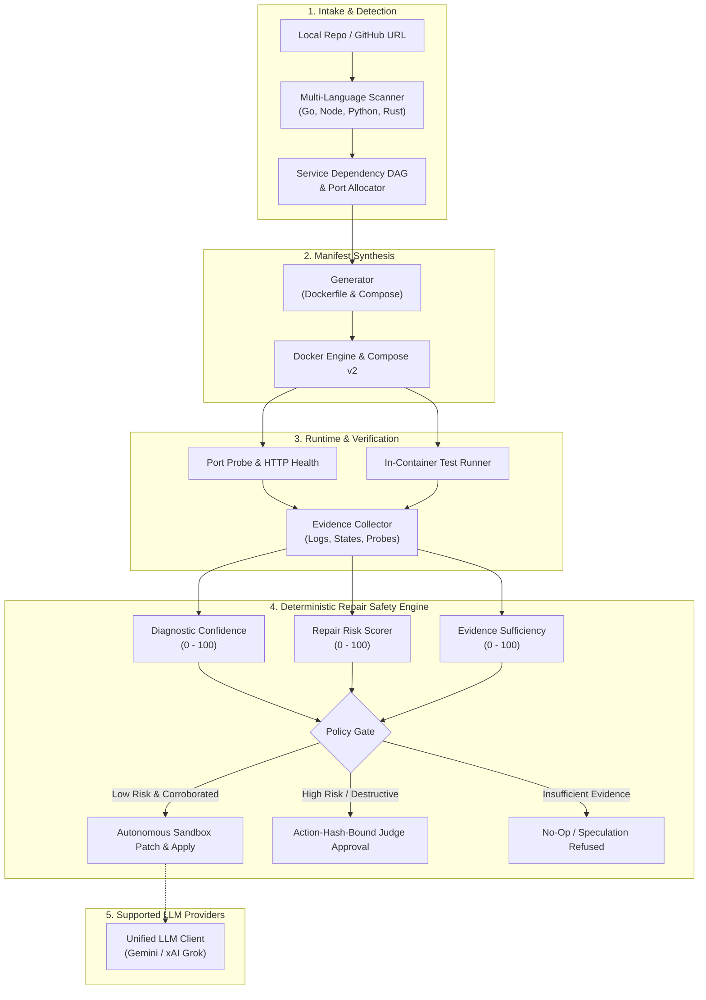

# ORQEN

> **Autonomous DevOps Platform, Container Orchestrator & Self-Healing Agent**

[](https://golang.org)
[](https://www.docker.com/)
[](LICENSE)
[](https://github.com/SUBHA22-CODER/ORQEN)

---

## 1. Project Overview

**ORQEN** is an autonomous, production-grade DevOps and infrastructure automation platform written in Go. It ingests source code from local projects or remote GitHub repositories, detects languages, dependencies, and backing services, dynamically generates reproducible Dockerfiles and Docker Compose manifests, orchestrates container lifecycles, runs automated in-container tests, monitors runtime health, and autonomously repairs build and runtime faults through a closed-loop, deterministic safety engine.

Designed for both beginners and experienced infrastructure engineers, ORQEN eliminates containerization guesswork while enforcing strict guardrails: **AI models advise, but deterministic safety gates decide.**

---

## 2. Problem Statement & Why ORQEN is Needed

Containerizing and deploying microservices remains plagued by manual friction:
1. **Container Configuration Drift**: Developers write mismatched Dockerfiles with incorrect ports, uninstalled runtime dependencies, and invalid startup commands (e.g. CLI applications crashing in clean-exit loops).
2. **Fragile AI "Autofixers"**: Generic AI coding assistants hallucinate fixes, modify untested infrastructure directly in production, risk data loss by recreating persistent volumes, and get caught in endless repair loops.
3. **Complex Local Environments**: Setting up multi-service dependencies (PostgreSQL, Redis, RabbitMQ, Elasticsearch) and managing port collisions requires tedious manual intervention.

**ORQEN solves this** by coupling an autonomous multi-language scanner and container manager with a **Deterministic Repair Safety Engine**:
- **Corroborated Evidence**: Diagnostics require multi-signal validation across Docker state, HTTP probes, and container logs.
- **Independent Safety Triad**: Diagnostic Confidence, Repair Risk, and Evidence Sufficiency are evaluated as separate mathematical dimensions.
- **Sandbox Pre-flight Verification**: Proposed changes are validated in isolated container environments before touching production.
- **Cryptographic Judge Approvals**: High-risk repairs require explicit authorization cryptographically bound to the proposed action hash.

---

## 3. Core Capabilities

- **Repository Analysis**: Automatic detection for Go, Node.js/TypeScript (npm, pnpm, yarn, bun, monorepos), Python (uv, poetry, pipenv, pip), and Rust (cargo).
- **Backing Service Inference**: Automatic provisioning of Redis, PostgreSQL, MySQL, MongoDB, and RabbitMQ with dynamic conflict-free host port allocation.
- **Automated Container Orchestration**: Generates hardened, multi-stage Dockerfiles and Compose configurations with zero manual drafting.
- **Automated In-Container Testing**: Executes detected test suites (`go test`, `pytest`, `npm test`, `cargo test`) directly inside running containers via `docker compose exec -T`.
- **Runtime Diagnostics & Healing**: Closed-loop health verification that distinguishes between clean exits (`exit 0` restart loops), OOM kills, and application crashes (`exit > 0`).
- **Cryptographic Action Approval**: Role-based judge authorizations with action-hash binding and replay protection.
- **Multi-Modal Interfaces**: Rich CLI, interactive Terminal UI (TUI), and a local Web Control Plane (`orqen serve`).

---

## 4. Architecture Overview



---

## 5. The Safety Triad & Policy Model

ORQEN's Repair Safety Engine never permits an LLM to self-authorize infrastructure modifications. Every proposed repair is evaluated across three **independent** metrics:

| Metric | Score Range | Description | Minimum Passing Threshold |
| :--- | :---: | :--- | :---: |
| **Diagnostic Confidence** | `0 - 100` | Statistical corroboration across independent signals (Docker inspect, HTTP probes, log evidence, reproducibility). | $\ge 70$ |
| **Evidence Sufficiency** | `0 - 100` | Measured independently of confidence. Asserts whether sufficient observational data exists to eliminate speculation. | $\ge 60$ |
| **Repair Risk** | `0 - 100` | Evaluates operation impact: volume deletion (Prohibited/Critical), port updates (Low), multi-file modifications (High). | $\le 40$ (for auto-apply) |

### Decision Outcomes:
1. **`auto_apply`**: High Confidence ($\ge 70$), Sufficient Evidence ($\ge 60$), and Low Risk ($\le 40$). Safe and reversible (pristine snapshot available).
2. **`require_approval`**: High Confidence and Sufficient Evidence, but Risk exceeds safe threshold ($> 40$). An action request is issued to an authorized human judge.
3. **`no_action`**: Low Confidence or Insufficient Evidence ($< 60$). ORQEN refuses to act on speculation.

---

## 6. Supported LLM Providers

ORQEN natively supports two production LLM providers via zero-dependency HTTP clients:

| Provider | Identifier | Required Environment Variable | Default Model | Base Endpoint |
| :--- | :---: | :--- | :---: | :--- |
| **Google Gemini** | `gemini` | `GEMINI_API_KEY` | `gemini-3.5-flash-lite` | Google Generative Language API |
| **xAI Grok** | `grok` | `XAI_API_KEY` | `grok-4.7` | `https://api.x.ai/v1` |

> [!NOTE]
> Provider API keys are strictly runtime configuration for ORQEN and are never passed into onboarded application containers. API keys are masked (`[REDACTED]`) in all logs and errors.

---

## 7. Technology Stack

- **Core Engine**: Go 1.27+
- **CLI & TUI**: Cobra, Bubble Tea, Lip Gloss, Bubbles
- **Container Infrastructure**: Docker Engine 28+, Docker Compose v2
- **Networking & Health**: Pure Go port probing, HTTP client with exponential backoff
- **LLM Integrations**: Native Go HTTP clients with tool-call schema support (Google Gemini & xAI Grok)

---

## 8. Project Structure

```
.
├── cmd/                        # CLI command implementations (Cobra)
│   ├── approvals.go            # Judge approval management
│   ├── assess.go / safety_cmd.go # Diagnostic assessment & safety-test CLI
│   ├── chat.go                 # Interactive terminal AI agent
│   ├── config.go / setup.go    # Provider & environment configuration
│   ├── doctor.go               # Local environment validation
│   ├── heal.go                 # Closed-loop healing entrypoint
│   ├── init.go                 # Repository intake & containerization
│   ├── serve.go                # Local web control plane
│   └── test.go                 # In-container automated testing runner
├── internal/
│   ├── agent/                  # DevOps agent loop, intents & tool execution
│   ├── config/                 # Configuration management & provider validation
│   ├── docker/                 # Docker CLI & Compose v2 orchestrator
│   ├── domain/                 # Core domain models (Project, Service, Container)
│   ├── generator/              # Dockerfile & Compose manifest generators
│   ├── healer/                 # Healing engine & runtime verification
│   ├── llm/                    # Gemini & xAI Grok HTTP clients & tool calling
│   ├── safety/                 # Deterministic Repair Safety Engine
│   │   ├── approval.go         # Action-hash-bound approvals & judge authorization
│   │   ├── assess.go           # Triad scoring & policy gate evaluation
│   │   ├── breaker.go          # Safety circuit breaker
│   │   ├── evidence.go         # Multi-signal evidence collector
│   │   └── sandbox.go          # Pre-flight sandbox verification
│   ├── scanner/                # Multi-language AST & manifest parsers
│   └── web/                    # Embedded web control plane assets & HTTP server
├── go.mod / go.sum             # Go module dependencies
├── Makefile                    # Automation targets
├── LICENSE                     # MIT License (Subha Prasana Parida)
└── README.md                   # Project documentation
```

---

## 9. Prerequisites & Installation

### Prerequisites
- **Go**: Version 1.27 or higher (`go version`)
- **Docker**: Docker Engine 28+ and Docker Compose v2 (`docker compose version`)
- **Git**: Version 2.30+

### Installation

```bash
# Clone the official repository
git clone https://github.com/SUBHA22-CODER/ORQEN.git
cd ORQEN

# Verify dependencies
go mod verify

# Build the executable
go build -o orqen.exe .
```

Verify your environment with the built-in diagnostic doctor:

```powershell
.\orqen.exe doctor
```

```
✓ Git installed
✓ Docker daemon reachable
✓ Docker Compose v2 available
✓ LLM provider configured
✓ OpenSSH client found
```

---

## 10. Configuration

Configure your chosen provider by creating a `.env` file or using the interactive setup:

### Interactive Setup Wizard:
```powershell
.\orqen.exe setup
```

### Manual Configuration (`.env`):
```bash
# Set provider to gemini or grok:
ORQEN_LLM_PROVIDER=gemini
GEMINI_API_KEY=your_actual_gemini_api_key

# Alternatively, for xAI Grok:
# ORQEN_LLM_PROVIDER=grok
# XAI_API_KEY=your_actual_xai_api_key
```

Verify configuration anytime:
```powershell
.\orqen.exe config show
```

---

## 11. CLI Usage & Practical Examples

### 1. Onboard a Local Repository or Project
Analyzes the codebase, generates Dockerfile & Compose stacks, binds conflict-free ports, and starts containers:
```powershell
.\orqen.exe init c:\path\to\my-app
```

### 2. Onboard a Remote GitHub Repository
```powershell
.\orqen.exe init https://github.com/username/sample-service
```

### 3. Run Automated Tests Inside Containers
Executes tests inside the running service containers and reports formatted pass/fail/skipped counts:
```powershell
.\orqen.exe test my-app
```

### 4. Assess Safety Scores (Dry-Run)
Inspects container telemetry, computes the Confidence/Risk/Sufficiency triad, and displays the deterministic policy decision without modifying anything:
```powershell
.\orqen.exe assess my-app --dry-run
```

### 5. Deterministic Safety Engine Verification
Executes verified test scenarios validating safe repairs, high-risk approvals, and insufficient-evidence blocks:
```powershell
.\orqen.exe safety-test
```

### 6. Start the Web Control Plane
Launches the persistent web dashboard and REST API:
```powershell
.\orqen.exe serve --host 127.0.0.1 --port 8420
```
Open [http://127.0.0.1:8420](http://127.0.0.1:8420) in your browser.

---

## 12. Human-in-the-Loop Judge Approval Workflow

When a proposed repair is deemed **High Risk** ($> 40$) but has sufficient corroborating evidence, ORQEN halts autonomous execution and creates a pending authorization request:

1. **List Pending Approvals**:
   ```powershell
   .\orqen.exe approvals list
   ```
2. **Inspect Action Details**:
   ```powershell
   .\orqen.exe approvals show <APPROVAL_ID>
   ```
   Displays the affected services, action hash (`sha256`), risk factors, and exact proposed file diff.
3. **Approve or Reject**:
   ```powershell
   # Authorize execution:
   .\orqen.exe approvals approve <APPROVAL_ID> --reason "Verified configuration diff"

   # Reject repair:
   .\orqen.exe approvals reject <APPROVAL_ID> --reason "Manual maintenance scheduled"
   ```

**Cryptographic Invariants**:
- Approvals are cryptographically bound to the target project and action hash.
- Tokens are strictly single-use (replay protected) with expiration timeouts.
- Natural language chit-chat or hypothetical questions can never authorize execution.

---

## 13. Testing Instructions

Run the complete test suite across all 27 packages:

```powershell
# Run all unit and integration tests (uncached)
go test -count=1 ./...

# Run static analysis
go vet ./...

# Verify code formatting
gofmt -l .
```

---

## 14. Security & Privacy Considerations

- **Non-Bypass Onboarding**: Repository onboarding requires explicit user confirmation.
- **Zero Secret Ingestion**: User secrets, PATs, and credentials are never stored in unencrypted state files or passed into application containers.
- **Circuit Breaker**: Prevents thrashing by halting automated repairs after 3 failed attempts.
- **Filesystem Isolation**: File manipulations are restricted to the target project directory via `internal/safefs`.

---

## 15. Limitations & Known Issues

- **Docker Compose v2 Required**: ORQEN uses Compose v2 (`docker compose`). Compose v1 (`docker-compose`) is not supported.
- **Windows Ephemeral Binding**: Ephemeral server testing requires local port binding privileges (`BypassSandbox: true` when running in isolated test environments).

---

## 16. Roadmap

- [ ] Kubernetes manifest generation (`k8s` / Helm chart exports).
- [ ] Multi-node remote Docker daemon orchestration.
- [ ] Automated vulnerability scanning integration (Trivy / Grype).
- [ ] Ephemeral preview environment tear-down automation.

---

## 17. License

This project is licensed under the **MIT License**. See the [LICENSE](LICENSE) file for complete details.

```
Copyright (c) 2026 Subha Prasana Parida
```

---

## 18. Author and Ownership Attribution

**ORQEN** is designed, developed, and maintained by:

### **Subha Prasana Parida**
- **GitHub**: [@SUBHA22-CODER](https://github.com/SUBHA22-CODER)
- **Official Repository**: [https://github.com/SUBHA22-CODER/ORQEN](https://github.com/SUBHA22-CODER/ORQEN)
- **Role**: Project Owner, Primary Author, and Maintainer

*Contributions, bug reports, and feedback are welcome! Please review [CONTRIBUTING.md](CONTRIBUTING.md) before submitting pull requests.*
